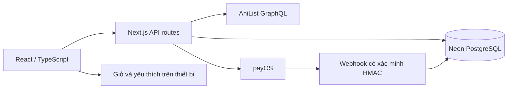
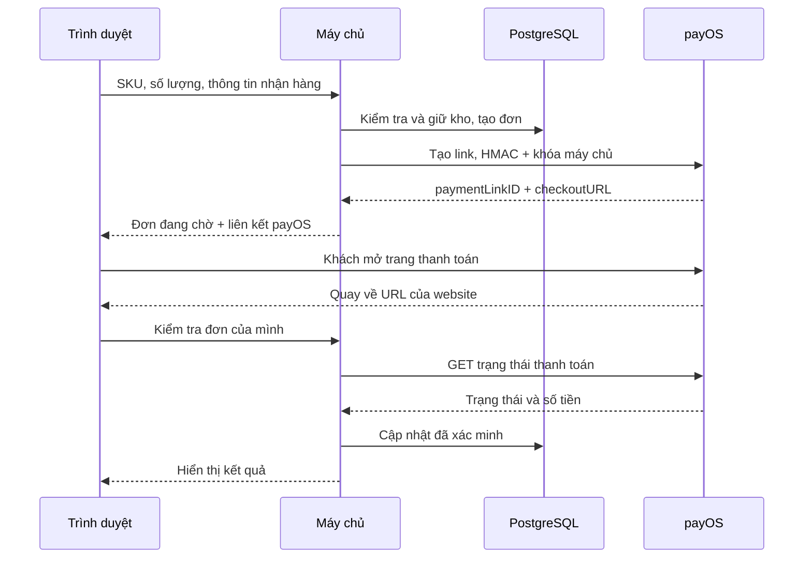

# Kế hoạch chi tiết — Komorebi

## 1. Mục tiêu và phạm vi

Xây website bán truyện tranh tiếng Việt để nộp bài thiết kế web, trình bày được một hành trình mua hàng đầy đủ. Mô hình là đặt **sách in minh họa**, không bán chương scan lấy từ API. Danh mục chọn 20 bộ manga, metadata/bìa thật từ AniList. Giá, tập 01, định dạng bìa mềm và tồn kho 20 cuốn/SKU là giả định của đồ án, được ghi rõ trong giao diện.

Các chức năng trong bản đầu: trang chủ, kệ truyện, tìm tên/tác giả có hoặc không dấu, lọc thể loại, sắp xếp giá/tên, xem chi tiết, lưu yêu thích, giỏ hàng, tính phí giao hàng, phiên khách, tạo đơn, xem lịch sử, hoàn tất minh họa, tạo liên kết payOS, kiểm tra trạng thái và hủy đơn đang chờ.

Không nằm trong bản đầu: kho sách thương mại thật, vận chuyển thực, tài khoản email/mật khẩu riêng, hệ quản trị nghiệp vụ đầy đủ, email thông báo, hóa đơn thuế, hoàn tiền, ví điện tử, ebook có DRM. Đây là các hạng mục mở rộng, không gắn nút giả trên giao diện.

## 2. Khảo sát và lựa chọn API

Đã khảo sát 9 dịch vụ, kết quả cụ thể trong [API-RESEARCH.md](API-RESEARCH.md). Đây là danh sách tiêu biểu, không phải toàn bộ API tồn tại trên Internet.

Chọn AniList vì truy vấn thật trả dữ liệu, có GraphQL phù hợp lấy nhiều trường, không cần khóa cho metadata công khai. Chỉ lưu bộ sưu tập 20 đầu truyện có chủ đích, không sao chép toàn thư viện. Kitsu là ứng viên dự phòng đã kiểm tra; chưa tích hợp adapter Kitsu vào bản đầu. Jikan bị timeout trong môi trường kiểm thử, OTruyen trả404; không chọn làm phụ thuộc bắt buộc. MangaDex trả dữ liệu nhưng điều khoản không phù hợp dịch vụ thu phí.

`GET /api/catalog` gọi AniList qua máy chủ để cập nhật điểm cộng đồng cho tập ID đã chọn. Cache1giờ khi thành công, fallback bản lưu khi lỗi với cache2phút. Search/filter dùng danh mục hiện có nên không gọi API mỗi phím gõ. Không hiển thị HTML từ mô tả API bằng `dangerouslySetInnerHTML`.

## 3. Thiết kế giao diện

Thương hiệu Komorebi: ánh nắng len qua kẽ lá. Màu cam cho kệ nổi bật, nền trắng, xanh rừng cho các điểm nhấn; Literata cho tiêu đề, Be Vietnam Pro cho chữ Việt. Font và bìa được lưu cục bộ để trình bày ít phụ thuộc mạng.

Trang chủ: thông báo giao hàng mẫu → header/tìm kiếm → navigation → kệ bìa truyện có thể chọn → lợi ích mua hàng → danh mục/filter → bộ sưu tập → câu chuyện của tiệm → FAQ → footer có nguồn dữ liệu/chính sách.

Desktop6cột, tablet3–4cột, điện thoại2cột. Checkout là ngăn bên ở desktop và toàn màn hình trên điện thoại. Modal dùng `<dialog>` với focus và Escape; nút có tên truy cập, ảnh có alt, chuyển động tắt khi người dùng yêu cầu giảm motion.

## 4. Kiến trúc

Stack: Next.js 16 App Router, React 19, TypeScript, GSAP, Vercel Functions (Singapore), Neon PostgreSQL miễn phí. SQL dùng tham số bind; các transaction thay đổi tồn kho được tuần tự hóa bằng PostgreSQL advisory lock. Không dùng SQLite trên filesystem tạm của Vercel.

Phiên khách 30 ngày: token ngẫu nhiên 256 bit, HMAC-SHA256 với SESSION_SECRET, cookie HttpOnly/Secure/SameSite=Lax. Đơn thuộc phiên trình duyệt, không phải tài khoản email; xóa cookie hoặc chuyển thiết bị sẽ không xem lại được. POST /api/session khởi tạo phiên, kiểm tra cùng Origin. Các đơn hàng luôn lọc owner_id. Giới hạn 5 đơn/phút/phiên và 30 yêu cầu tạo đơn/phút/IP; IP được băm HMAC trước khi lưu.

## 5. Cấu trúc dữ liệu

| Bảng/nguồn | Trường chính | Vai trò |
| --- | --- | --- |
| `app/data/metadata.json` | AniListID, title, coverImage, staff, genres, averageScore | Metadata tham khảo đã chọn |
| `lib/catalog.ts` | SKU `al-ID`, titleVi, price, volume, format | Giá và cấu hình hàng mẫu; nguồn giá có thẩm quyền |
| `inventory` | product_id PK, stock CHECK>=0 | Tồn kho minh họa, được giữ khi tạo đơn |
| `orders` | id UUID, owner_id, order_code UNIQUE, idempotency_key, status, mode, amount, subtotal, shipping, customer_json, items_json, checkout_url, payment_link_id, timestamps | Đơn hàng và ảnh chụp giá/thông tin tại lúc mua |
| `payment_events` | reference PK, order_id, received_at | Dấu vết webhook, chống ghi lặp |

Giá dùng số nguyên VND. Giao hàng25.000đ, miễn phí khi subtotal>=199.000đ. Mỗi SKU tối đa10cuốn/đơn. Client chỉ gửi ID và số lượng; trường giá/tổng tiền do client gửi bị bỏ qua.

## 6. API nội bộ

| Route | Quyền | Chức năng |
| --- | --- | --- |
| `GET /api/catalog` | Đọc công khai trên website | Metadata live hoặc fallback |
| `GET /api/config` | Đọc | Chỉ báo payOS sẵn sàng và phí giao hàng, không lộ khóa |
| `GET /api/orders` | Phiên khách có chữ ký | Tối đa50đơn mới nhất của chính người dùng |
| `POST /api/orders` | Phiên khách có chữ ký, cùng Origin | Validate, tính lại giá, giữ kho và tạo đơn |
| `GET /api/orders/:id` | Chủ đơn | Đọc đơn và đối soát payOS nếu là đơn thật |
| `POST /api/orders/:id` | Chủ đơn, cùng Origin | Hủy đơn hoặc hoàn tất đơn minh họa |
| `POST /api/webhooks/payos` | Chữ ký payOS hợp lệ | Xác minh và cập nhật PAID |

Mã đơn ngẫu nhiên theo thời điểm, ID riêngUUID. Không coi mã đơn là quyền truy cập. Mọi truy vấn đơn đều lọc `owner_id`. Mã idempotency unique theo chủ đơn giúp nhấn gửi lại không tạo2đơn.

## 7. Luồng thanh toán payOS

1. Khách kiểm tra giỏ và thông tin nhận hàng. Mặc định là **đơn minh họa**; payOS thật phải chọn rõ và xác nhận thông tin giao dịch.
2. Máy chủ xác thực phiên, Origin, SKU, số lượng, tên, điện thoại/email/địa chỉ; tính tổng theo dữ liệu tin cậy.
3. PostgreSQL transaction ghi đơn CREATING và trừ kho trong cùng transaction. CHECK stock>=0 ngăn bán vượt kho kể cả gửi đồng thời.
4. Đơn demo chuyển PENDING. Đơn live tạo HMAC-SHA256 trên đúng5trường `amount,cancelUrl,description,orderCode,returnUrl` và gửi `POST /v2/payment-requests` đến payOS với header client/API key.
5. Lưu checkoutURL/paymentLinkID, hiện nút mở trang payOS. Link hết hạn15phút. Không tự chuyển tiền.
6. Trang quay về chỉ mang ID đơn. Máy chủ đọc trạng thái bằng payOS API; `?status=PAID` trên URL không thay đổi DB.
7. Webhook kiểm tra HMAC bằng checksum key, code thành công, currencyVND, orderCode, paymentLinkID và amount khớp. Sự kiện trùng không trừ kho hoặc ghi nhận tiền lần2.
8. Khi hủy, đơn live chỉ được nhả kho sau phản hồi CANCELLED từ payOS. Đơn demo hoàn tất mang trạng thái DEMO_COMPLETE và nhả kho mẫu; không bao giờ giả PAID.
9. Nếu tạo link timeout, giữ đơn chờ và kho; tra lại theo orderCode để tránh tạo thêm một link khi phía payOS thực ra đã nhận yêu cầu.

## 8. Cấu hình khóa và triển khai

Biến máy chủ: `DATABASE_URL`, `SESSION_SECRET`, `PAYOS_CLIENT_ID`, `PAYOS_API_KEY`, `PAYOS_CHECKSUM_KEY`, `APP_URL`, `PAYMENT_MODE`. Khóa payOS được lưu dưới dạng Sensitive trong Vercel Production; không có trong Git, HTML, public/, biến NEXT_PUBLIC hay bundle trình duyệt. `.env.example` chỉ là mẫu; local dùng `.env.local` đã được ignore.

Dự án Vercel `komorebi-manga`, GitHub `hoquan2007/Animes_fake`, Root Directory `komorebi`. Neon resource `komorebi-db`, khu vực Singapore, gói Free. Chạy `npm run db:migrate` khi DATABASE_URL đã được cấp. APP_URL trỏ về URL production cố định. Preview không tự bật khóa payOS thật.

Webhook công khai: `/api/webhooks/payos`. Đăng ký với kênh payOS sau khi deployment sẵn sàng; không đặt Vercel Authentication trước endpoint này. HMAC vẫn là điều kiện bắt buộc để xử lý. Đối soát bằng API hoạt động khi mở đơn, kể cả webhook chậm. Kết quả triển khai và xác minh thực tế nằm trong DEPLOYMENT.md.

## 9. Kế hoạch thực hiện và nghiệm thu

| Giai đoạn | Đầu ra | Tiêu chí nghiệm thu |
| --- | --- | --- |
| 1. Khảo sát API | Báo cáo9nguồn và script kiểm tra | HTTP/schema/lỗi ghi thật, tách điều khoản và khả dụng |
| 2. Thiết kế | Direction, copy, responsive, ảnh/font | Không ảnh vỡ, không tràn ngang, thao tác được trên điện thoại |
| 3. Danh mục |20bộ, tìm/lọc/sắp xếp/chi tiết/yêu thích | Trạng thái rỗng rõ ràng, query trong URL, giỏ giữ qua reload |
| 4. Đặt hàng | PostgreSQL schema, form, giỏ, lịch sử | Tính tiền ở server, kiểm tra người sở hữu, không bán vượt kho |
| 5. Thanh toán | Demo + payOS + đối soát + webhook handler | Demo khác PAID; không tin returnURL; HMAC giả bị loại |
| 6. Kiểm thử | Typecheck, build, unit/integration/UI | Chạy kiểm tra đúng phạm vi, ghi rõ phần chưa thử bằng giao dịch thật |
| 7. Bàn giao | Source, README, plan, ảnh, URL Vercel công khai | Chạy lại được, không commit secret, nộp bài có kịch bản demo |

## 10. Mở rộng nếu thành cửa hàng thật

Thay catalog mẫu bằng SKU/ISBN/ấn bản/ngôn ngữ/ảnh có quyền sử dụng và hàng tồn thực; bổ sung admin với phân quyền; dịch vụ vận chuyển; job đối soát/hết hạn để xử lý đơn bị bỏ dở; bảo lưu thông tin giao dịch khi hết kho; email và hóa đơn; workflow hoàn tiền; chính sách dữ liệu và hàng hóa. Kiểm tra điều khoản nguồn API và quyền phân phối từng nội dung trước khi kinh doanh.

## 11. Kịch bản trình bày bài tập

Mở trang trên desktop và điện thoại → tìm `naruto` → lọc thể loại/sắp giá → lưu một truyện → thêm vào giỏ → thay số lượng xem phí ship → khởi tạo phiên khách → tạo đơn minh họa → hoàn tất → mở lại lịch sử. Sau đó giải thích code tính giá, PostgreSQL transaction, chữ ký payOS và vì sao không tin tham số `status` của trình duyệt. Nếu trình bày payOS, chỉ tạo/mở link; không cần chuyển tiền thật để chấm giao diện.
